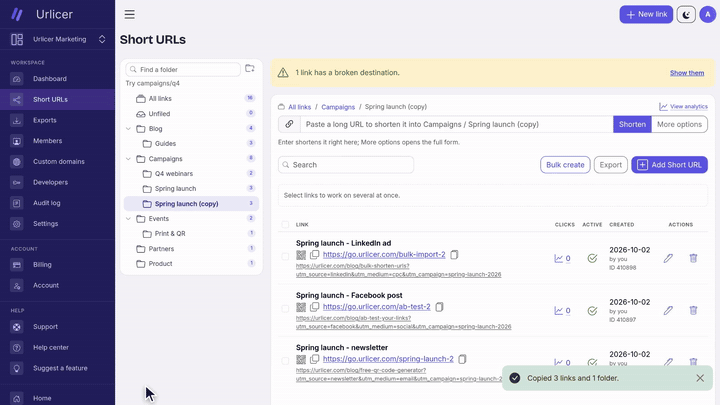

# motion-videos

Product videos made from web pages, with Claude Code doing the work.


*Drawn: a web page animated with CSS. No screenshots, no video editor. This is the start of the
walkthrough made for [Urlicer](https://urlicer.com); the full 41 seconds, with music, is
[on YouTube](https://youtu.be/5QqihS1RYZA).*



*Recorded: the real app, driven by a script. Nobody is holding the mouse. Change the UI, run the
script again, get the same video of the new UI.*

Both were made with what is in this repo. A video is a plain HTML page animated with CSS, or your
real app driven by a script. Headless Chrome takes one screenshot per frame and ffmpeg encodes
them. No React, no Remotion. The repo includes the Claude Code skill and a set of prompts to direct it.

## What you need

- Node 18 or newer
- Chrome or Chromium
- ffmpeg
- Claude Code, if you want it to make the videos for you (the kit also works by hand)

## 1. Try it

```bash
git clone https://github.com/ivanvoitovych/motion-videos.git
cd motion-videos
npm install
npm run check        # says what is missing, if anything
npm run hello        # out/hello-wide.mp4 and out/hello-wide.jpg, in under a minute
npm run hello:music  # out/hello-music.mp4: the same video with sound
```

The second example records a real web app. It films a small sample app that ships in this repo,
so it needs nothing of yours:

```bash
npm run tour:check   # runs the script fast: does every step still find its target?
npm run tour:record  # the take, about 5 minutes
npm run tour         # out/tour-wide.mp4, about 5 more minutes
```

## Preview in the browser, without rendering

Open a video's `index.html` in Chrome and it plays. A scrubber at the bottom seeks by hand. Add
`?format=tall` for the portrait layout, `?cut=slow` for the example's slower cut.

This is the fast way to review: no waiting for a render. What you do not see there is what ffmpeg
adds afterwards: motion blur (`--blur`), the encoding, and the music. Timing, layout, words and
motion are the same as in the MP4.

## 2. Make your own, with Claude Code

Start Claude Code in this folder. The skill in `.claude/skills/promo-video/` loads by itself.
Give it the brief, with your own address:

```
Use the promo-video skill. My app runs at http://localhost:3000. You are the director and
the one who has to sell this. Look at the app, fill in the Project settings table in the
skill, then pitch me three scenarios, one idea each: the hook, a shot list as a table
(time, action on screen, caption), and the closing line. Nothing gets built until I pick.
```

Pick a scenario, change it until you like it, then say "build it". Claude Code puts the video in
`videos/<name>/`, shows you still frames, and renders the MP4 when the frames look right.

## 3. Expect to direct it

**The first version will most likely not be what you had in mind.** That is normal, and it is not
a reason to stop. Claude Code cannot see the video the way you do and cannot hear the music at all.
You screen it, you give notes, it fixes them, and you screen it again.

The first cut made with this kit was a slideshow. The good ones came from notes like these:

- "First cut is a slideshow. Nothing happens. I want the interface to act."
- "Too many pauses. Cut the dead air."
- "This scene reads as our bug. Name the cause on screen."
- "The text shakes during the zoom. Find the cause and fix it at the source."
- "The guitar sounds synthetic. The music serves the reading."

You do not need the vocabulary of a film set. Say what you see and what you expected. When you
cannot describe what you want, ask for options: "give me five directions in a table".
[PROMPTS.md](PROMPTS.md) has the full set, ready to paste.

## 4. Change things

| You want to | Say to Claude Code | Or do it by hand |
|---|---|---|
| Change the words on screen | "Change the headline to ..." | Edit the block marked `COPY` in the video's `index.html` |
| Make it faster or slower | "Too many pauses. Cut the dead air." | The start times at the top of the page's `<style>` |
| Use your colours and fonts | "Use my brand: ..." | The tokens at the top of `lib/stage.css` |
| Get a portrait version | "Make a tall layout" | `--format tall`, and `[data-format="tall"]` rules in the page |
| Get a slower edit for YouTube | "Add a cut called yt where every scene can be read" | `--cut yt`, and `[data-cut="yt"]` rules in the page (see `examples/hello`, cut `slow`) |
| Re-shoot after your UI changed | "The UI changed. Run the take again and fix what broke." | `node videos/<name>/record.mjs --dry`, then without `--dry` |
| Change what the script does in your app | "After saving, open the settings page" | The steps in `videos/<name>/record.mjs` |
| Add music | "Score this. Five directions in a table first." | Copy `examples/hello/music.mjs`, edit, run |
| Make the music quieter | "Piano down, lose the pulse." | `LEVEL` at the top of `music.mjs` |
| Get a thumbnail | nothing: it is made with every render | `out/<name>-<format>.jpg`, which is frame 0 |

Every one of these is explained, with examples, in [ADAPT.md](ADAPT.md).

## Use the skill from another project

Copy `.claude/skills/promo-video/` into `~/.claude/skills/` and it is available in every project.
In its Project settings table, set "Kit folder" to where you cloned this repo.

## What is in here

| Path | What |
|---|---|
| `render.mjs` | Page to MP4, frame by frame: formats, cuts, motion blur, still frames, the thumbnail |
| `lib/stage.js`, `lib/stage.css` | Loaded by every video page: seeking, the stage, safe zones, colour and font tokens |
| `lib/recorder.mjs` | Drives a real app from a scenario and saves the take |
| `lib/clip.js` | Plays a take inside a video page, and draws the cursor, clicks, camera and captions |
| `lib/band.mjs` | Music and sounds made in code: piano, pad, bell, blips, drums, plucked strings |
| `examples/hello` | A drawn video, 9 seconds, with its music and a slower cut |
| `examples/new-order` | A drawn video of an app screen, built from the app's own stylesheet |
| `examples/sample-app`, `examples/tour` | A sample app and a recorded video of it |
| `videos/` | Yours |
| `media/` | The two previews at the top of this page |
| `.claude/skills/promo-video/SKILL.md` | The skill: how to make a video, the rules, the traps |
| `ADAPT.md` | How to adjust everything |
| `PROMPTS.md` | Prompts to paste: planning, building, notes after a screening, music |
| `docs/playbook.md` | What holds attention in a product video, with sources |

## Where it came from

The kit was built to make the product videos of [Urlicer](https://urlicer.com), a link shortener
for teams: short feature videos, a walkthrough, YouTube edits and ads, some drawn and some recorded
from the real app. The two previews at the top are from those. Their source pages and scripts are
not in this repo: they are the product's own design, and a script that drives a real product
should not be handed around. The examples here use a made-up sample app, so you can run
everything without touching anyone's live site.

## How it works, in four sentences

A drawn page is a function of time: the renderer pauses every CSS animation, sets it to the moment
of each frame, and takes a screenshot. A real app cannot be paused, so it runs in slow motion:
animations at one tenth of the speed, timers stretched ten times, one frame every third of a second.
The cursor, click rings, camera moves and captions are not in the recording; they are drawn from a
timeline when the video is rendered, so they can be restyled without a new take. Either way the
frame rate is exact, and a slow machine only renders slower.

## Limits

- **Slow.** Measured on an 8 GB machine under WSL, with the examples here: the 9 s `hello` video
  rendered in 23 s at 16:9, in 43 s with `--blur 2`, and in 87 s in portrait with `--blur 4`. The 26 s take of the
  sample app recorded in 260 s, and its 31 s video rendered in another 260 s.
- **One at a time.** Every render is a whole Chrome. Five in parallel ran that machine out of memory.
- **Not everything can be filmed.** The browser's own dropdown list and colour picker are not part
  of the page: the value just changes.
- **A take is not a speed test.** The page is slowed, the network is not.
- **The music is modelled, not recorded.** It is free of rights and good enough to sit under a
  video quietly. A distorted guitar from it sounds artificial.
- **Portrait safe zones are from third-party guides.** Check them with one private upload.
- **A page only renders in the shapes it has a layout for.** It lists them in
  `<html data-formats="wide tall">`, and the renderer refuses the others.
- **Tested on Linux under WSL only.** macOS and Windows paths for Chrome are in `lib/chrome.mjs`
  but have not been run there.

## Licence

MIT. The fonts are the system's; nothing else is bundled.
